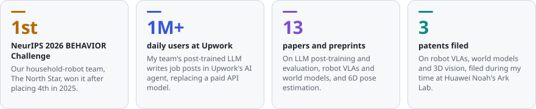
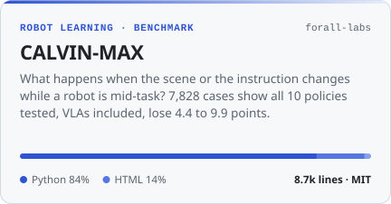
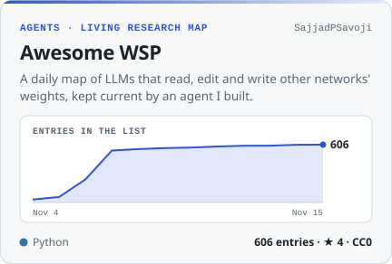

<a href="https://sajjadpsavoji.github.io">
  <picture>
    <source media="(prefers-color-scheme: dark)" srcset="assets/banner-dark.svg">
    
  </picture>
</a>

  <a href="https://sajjadpsavoji.github.io"><picture><source media="(prefers-color-scheme: dark)" srcset="assets/link-website-dark.svg"></picture></a>
  <a href="https://scholar.google.com/citations?user=DZzLzNwAAAAJ"><picture><source media="(prefers-color-scheme: dark)" srcset="assets/link-scholar-dark.svg"></picture></a>
  <a href="https://huggingface.co/savoji"><picture><source media="(prefers-color-scheme: dark)" srcset="assets/link-huggingface-dark.svg"></picture></a>
  <a href="https://www.linkedin.com/in/sajjadpsavoji"><picture><source media="(prefers-color-scheme: dark)" srcset="assets/link-linkedin-dark.svg"></picture></a>
  <a href="https://x.com/saavoji"><picture><source media="(prefers-color-scheme: dark)" srcset="assets/link-x-dark.svg"></picture></a>
  <a href="https://forall-labs.github.io"><picture><source media="(prefers-color-scheme: dark)" srcset="assets/link-forall-dark.svg"></picture></a>

<picture>
  <source media="(prefers-color-scheme: dark)" srcset="assets/highlights-dark.svg">
  
</picture>

## About

I take foundation models from research to real use: I post-train them on real data, measure exactly where they fail, and keep them improving after people start using them. Over the last six years that has meant LLMs in production, robot policies in simulation and on hardware, and 3D vision for warehouses and city streets.

**What I do now: LLMs at Upwork.** I lead a five-person team that owns the model writing job posts inside Upwork's AI agent, used by more than a million people a day. We replaced a paid API model with an open Qwen model that we post-train ourselves on 100+ GPUs. It costs about 70% less, judges rate its posts 18% higher, and in A/B tests it raised post-to-hire conversion by 9%. The product keeps changing, so I built the loop that keeps the model current: it picks which new data is worth training on by matching gradients, guards against forgetting old skills, scores outputs with a panel of LLM judges we calibrated, and ships changes through A/B tests.

**Before that: robots at Huawei Noah's Ark Lab.** I post-trained vision-language-action policies (π0.5, GR00T, OpenVLA) and video world models for long household tasks, generated synthetic training scenes with diffusion models, and built simulation benchmarks that show where robot policies break: clutter, distractors and new environments. Our team, The North Star, won the NeurIPS 2026 BEHAVIOR Challenge. I also built zero-shot 6D and 9DoF pose estimation, so warehouse robots can pick up boxes and objects they have never seen, even when they are partly hidden.

**Earlier:** at the Vector Institute I built multi-agent LLM workflows, RAG and evaluation for banks (CIBC, TD), and at Trans-Plan I shipped a multi-camera 3D tracking system for traffic analytics.

**On the side:** I run open studies with [Forall Labs](https://forall-labs.github.io), such as how robot policies cope when a task changes halfway through and how open LLMs fail at writing robot code (below).

**Next:** multimodal agents that keep learning from real-world feedback.

<a href="https://github.com/SajjadPSavoji/Resume/blob/master/Sajjad_Pakdamansavoji_CV.pdf"><picture><source media="(prefers-color-scheme: dark)" srcset="assets/link-cv-dark.svg"></picture></a>

## Featured open source

  <a href="https://github.com/forall-labs/CALVIN-MAX"><picture><source media="(prefers-color-scheme: dark)" srcset="assets/card-calvin-max-dark.svg"></picture></a>
  <a href="https://github.com/forall-labs/OpenCaP"><picture><source media="(prefers-color-scheme: dark)" srcset="assets/card-opencap-dark.svg"></picture></a>

  <a href="https://github.com/forall-labs/AutoPolish"><picture><source media="(prefers-color-scheme: dark)" srcset="assets/card-autopolish-dark.svg"></picture></a>
  <a href="https://github.com/SajjadPSavoji/awesome-weight-space-programming"><picture><source media="(prefers-color-scheme: dark)" srcset="assets/card-awesome-wsp-dark.svg"></picture></a>

  <a href="https://github.com/SajjadPSavoji/MiniVLMDocEval"><picture><source media="(prefers-color-scheme: dark)" srcset="assets/card-minivlmdoceval-dark.svg"></picture></a>
  

## Selected publications

| Venue | Paper | Links |
|:--|:--|:--|
| **Preprint** | **OLGA: Online Label-Free Gradient Matching for Continual Language Model Training** First author · LLM continual learning | [arXiv](https://arxiv.org/abs/2611.03496) |
| **Preprint** | **Prompt Lottery in LLM-as-a-Judge: Measuring and Mitigating Sensitivity to Syntactic Rephrasing** LLM evaluation | [arXiv](https://arxiv.org/abs/2610.38076) |
| **Preprint** | **Fragility Is Not Reducible to Hardness: Conditional Causal Difficulty for LLMs** LLM robustness | [arXiv](https://arxiv.org/abs/2611.02065) |
| **IROS 2026** | **How VLAs (Really) Work In Open-World Environments** Robot VLAs | [arXiv](https://arxiv.org/abs/2604.21192)&nbsp;·&nbsp;[Page](https://sajjadpsavoji.github.io/How-VLAs-Really-Work/) |
| **ICRA 2026** | **Improving Robotic Manipulation Robustness via NICE Scene Surgery** First author · Robot manipulation | [arXiv](https://arxiv.org/abs/2511.22777)&nbsp;·&nbsp;[Page](https://sajjadpsavoji.github.io/NICE-Scene-Surgery/) |
| **ICRA 2026** | **Distracted Robot: How Visual Clutter Undermine Robotic Manipulation** Robot manipulation | [arXiv](https://arxiv.org/abs/2511.22780)&nbsp;·&nbsp;[Page](https://sajjadpsavoji.github.io/Distracted-Robot/) |
| **Preprint** | **Do World Action Models Generalize Better than VLAs? A Robustness Study** World models · Robot VLAs | [arXiv](https://arxiv.org/abs/2603.22078)&nbsp;·&nbsp;[Page](https://sajjadpsavoji.github.io/World-Action-Model-Robustness/) |
| **WACV 2026** | **WALDO: Where Unseen Model-based 6D Pose Estimation Meets Occlusion** First author · 6D pose | [arXiv](https://arxiv.org/abs/2511.15874)&nbsp;·&nbsp;[Page](https://sajjadpsavoji.github.io/WALDO/) |
| **ECCV&nbsp;2026&nbsp;W** | **AnyBox: Efficient Zero-Shot 9DoF Pose Estimation of Boxes for Robotic Manipulation** Equal contribution · 9DoF pose | [arXiv](https://arxiv.org/abs/2511.15884)&nbsp;·&nbsp;[Page](https://sajjadpsavoji.github.io/AnyBox/) |
| **ITSC 2024** | **Ground Plane Projection for Improved Traffic Analytics at Intersections** First author · 🏆 Best Application Paper | [arXiv](https://arxiv.org/abs/2511.12342)&nbsp;·&nbsp;[Page](https://sajjadpsavoji.github.io/Ground-Plane-Projection/) |

Full list on <a href="https://scholar.google.com/citations?user=DZzLzNwAAAAJ">Google Scholar</a>.

## Experience

<picture>
  <source media="(prefers-color-scheme: dark)" srcset="assets/experience-dark.svg">
  
</picture>

**Education:** M.Sc. Computer Science, York University · B.Sc. Electrical Engineering, University of Tehran

## Toolbox

<picture>
  <source media="(prefers-color-scheme: dark)" srcset="assets/toolbox-dark.svg">
  
</picture>

## Recent

- **Nov 2026** · Released [Awesome Weight-Space Programming](https://github.com/SajjadPSavoji/awesome-weight-space-programming), a daily, agent-curated map of LLMs that read, edit and write network weights
- **Nov 2026** · Released [OpenCaP](https://forall-labs.github.io/OpenCaP/) and [CALVIN-MAX](https://forall-labs.github.io/CALVIN-MAX/), two open Forall Labs studies of robot code generation and mid-execution task changes
- **Nov 2026** · [OLGA](https://arxiv.org/abs/2611.03496), online label-free gradient matching for continual LM training, is on arXiv
- **Oct 2026** · 1st place in the NeurIPS 2026 BEHAVIOR Challenge with team The North Star

---

Say hello on <a href="https://www.linkedin.com/in/sajjadpsavoji">LinkedIn</a> or through <a href="https://sajjadpsavoji.github.io/contact.html">my website</a>. More work at <a href="https://sajjadpsavoji.github.io/projects.html">sajjadpsavoji.github.io</a>. Icons: Lucide (ISC), Simple Icons and SVG Logos (CC0); brand marks belong to their owners.

