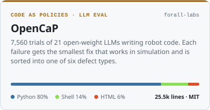
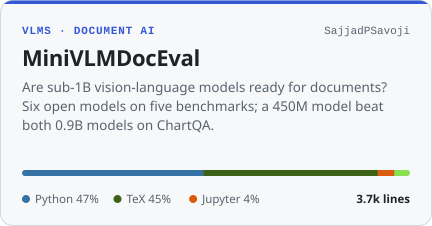
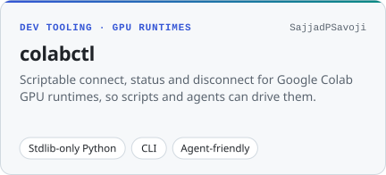
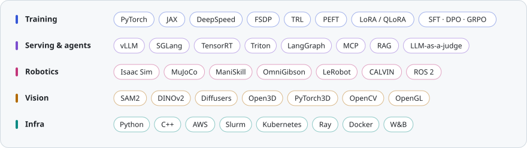

<a href="https://sajjadpsavoji.github.io">
  <picture>
    <source media="(prefers-color-scheme: dark)" srcset="assets/banner-dark.svg">
    
  </picture>
</a>

  
  
  
  
  
  

<picture>
  <source media="(prefers-color-scheme: dark)" srcset="assets/highlights-dark.svg">
  
</picture>

## About

I'm an AI research scientist with 6+ years of experience training, post-training and evaluating foundation models.
At **Upwork** I lead the team that owns the job-post generation model behind Upwork's AI agent. We replaced a paid
API model in production with a post-trained open model that is cheaper and rated higher, and we keep improving it
through a continual-learning data flywheel. Before that, at **Huawei Noah's Ark Lab**, I post-trained robot VLAs and
world models, and our team, The North Star, won the **NeurIPS 2026 BEHAVIOR Challenge**. I also release open
research with **[Forall Labs](https://forall-labs.github.io)**.

My focus now is **multimodal agents that learn continually from real-world feedback**.

<table>
  <tr>
    <td width="33%" valign="top">
      <h4>LLMs &amp; agents</h4>
      Post-training and continual learning at production scale: label-free gradient matching for data selection,
      forgetting mitigation, and LLM-as-a-judge evaluation you can trust.
    </td>
    <td width="33%" valign="top">
      <h4>Embodied AI</h4>
      Post-training robot VLAs (π0.5, GR00T, OpenVLA) and DiT world models, plus benchmarks that show where
      manipulation policies break in the open world.
    </td>
    <td width="33%" valign="top">
      <h4>3D &amp; multimodal vision</h4>
      Zero-shot 6D/9DoF pose estimation under occlusion, multi-camera 3D perception, and small VLMs for
      document understanding.
    </td>
  </tr>
</table>

## Featured open source

  <a href="https://github.com/forall-labs/CALVIN-MAX"><picture><source media="(prefers-color-scheme: dark)" srcset="assets/card-calvin-max-dark.svg"></picture></a>
  <a href="https://github.com/forall-labs/OpenCaP"><picture><source media="(prefers-color-scheme: dark)" srcset="assets/card-opencap-dark.svg"></picture></a>

  <a href="https://github.com/forall-labs/AutoPolish"><picture><source media="(prefers-color-scheme: dark)" srcset="assets/card-autopolish-dark.svg"></picture></a>
  <a href="https://github.com/SajjadPSavoji/awesome-weight-space-programming"><picture><source media="(prefers-color-scheme: dark)" srcset="assets/card-awesome-wsp-dark.svg"></picture></a>

  <a href="https://github.com/SajjadPSavoji/MiniVLMDocEval"><picture><source media="(prefers-color-scheme: dark)" srcset="assets/card-minivlmdoceval-dark.svg"></picture></a>
  

## Selected publications

| Venue | Paper | Links |
|:--|:--|:--|
| **Preprint** | **OLGA: Online Label-Free Gradient Matching for Continual Language Model Training** First author · LLM continual learning | [arXiv](https://arxiv.org/abs/2611.03496) |
| **Preprint** | **Prompt Lottery in LLM-as-a-Judge: Measuring and Mitigating Sensitivity to Syntactic Rephrasing** LLM evaluation | [arXiv](https://arxiv.org/abs/2610.38076) |
| **Preprint** | **Fragility Is Not Reducible to Hardness: Conditional Causal Difficulty for LLMs** LLM robustness | [arXiv](https://arxiv.org/abs/2611.02065) |
| **IROS 2026** | **How VLAs (Really) Work In Open-World Environments** Robot VLAs | [arXiv](https://arxiv.org/abs/2604.21192)&nbsp;·&nbsp;[Page](https://sajjadpsavoji.github.io/How-VLAs-Really-Work/) |
| **ICRA 2026** | **Improving Robotic Manipulation Robustness via NICE Scene Surgery** First author · Robot manipulation | [arXiv](https://arxiv.org/abs/2511.22777)&nbsp;·&nbsp;[Page](https://sajjadpsavoji.github.io/NICE-Scene-Surgery/) |
| **ICRA 2026** | **Distracted Robot: How Visual Clutter Undermine Robotic Manipulation** Robot manipulation | [arXiv](https://arxiv.org/abs/2511.22780)&nbsp;·&nbsp;[Page](https://sajjadpsavoji.github.io/Distracted-Robot/) |
| **Preprint** | **Do World Action Models Generalize Better than VLAs? A Robustness Study** World models · Robot VLAs | [arXiv](https://arxiv.org/abs/2603.22078)&nbsp;·&nbsp;[Page](https://sajjadpsavoji.github.io/World-Action-Model-Robustness/) |
| **WACV 2026** | **WALDO: Where Unseen Model-based 6D Pose Estimation Meets Occlusion** First author · 6D pose | [arXiv](https://arxiv.org/abs/2511.15874)&nbsp;·&nbsp;[Page](https://sajjadpsavoji.github.io/WALDO/) |
| **ECCV&nbsp;2026&nbsp;W** | **AnyBox: Efficient Zero-Shot 9DoF Pose Estimation of Boxes for Robotic Manipulation** Equal contribution · 9DoF pose | [arXiv](https://arxiv.org/abs/2511.15884)&nbsp;·&nbsp;[Page](https://sajjadpsavoji.github.io/AnyBox/) |
| **ITSC 2024** | **Ground Plane Projection for Improved Traffic Analytics at Intersections** First author · 🏆 Best Application Paper | [arXiv](https://arxiv.org/abs/2511.12342)&nbsp;·&nbsp;[Page](https://sajjadpsavoji.github.io/Ground-Plane-Projection/) |

Full list on <a href="https://scholar.google.com/citations?user=DZzLzNwAAAAJ">Google Scholar</a>.

## Experience

<picture>
  <source media="(prefers-color-scheme: dark)" srcset="assets/experience-dark.svg">
  
</picture>

**Education:** M.Sc. Computer Science, York University · B.Sc. Electrical Engineering, University of Tehran

## Toolbox

<picture>
  <source media="(prefers-color-scheme: dark)" srcset="assets/toolbox-dark.svg">
  
</picture>

## Recent

- **Nov 2026** · Released [Awesome Weight-Space Programming](https://github.com/SajjadPSavoji/awesome-weight-space-programming), a daily, agent-curated map of LLMs that read, edit and write network weights
- **Nov 2026** · Released [OpenCaP](https://forall-labs.github.io/OpenCaP/) and [CALVIN-MAX](https://forall-labs.github.io/CALVIN-MAX/), two open Forall Labs studies of robot code generation and mid-execution task changes
- **Nov 2026** · [OLGA](https://arxiv.org/abs/2611.03496), online label-free gradient matching for continual LM training, is on arXiv
- **Oct 2026** · 1st place in the NeurIPS 2026 BEHAVIOR Challenge with team The North Star

---

Say hello on <a href="https://www.linkedin.com/in/sajjadpsavoji">LinkedIn</a> or through <a href="https://sajjadpsavoji.github.io/contact.html">my website</a>. More work at <a href="https://sajjadpsavoji.github.io/projects.html">sajjadpsavoji.github.io</a>.

