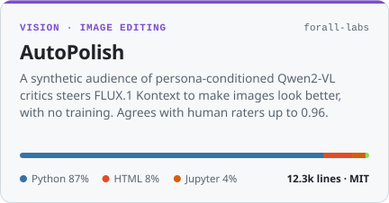
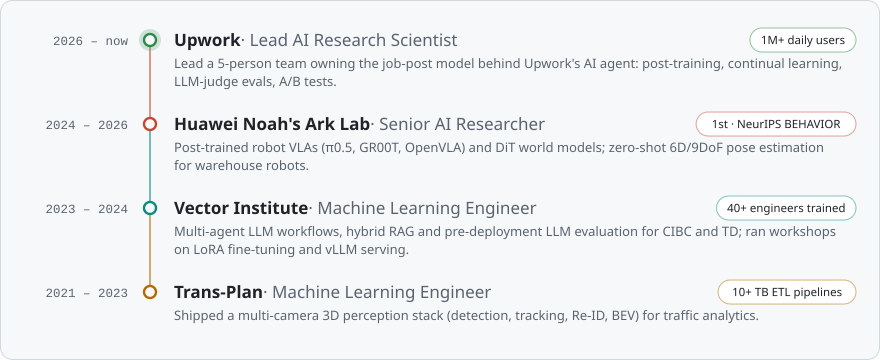

<a href="https://sajjadpsavoji.github.io">
  <picture>
    <source media="(prefers-color-scheme: dark)" srcset="assets/banner-dark.svg">
    
  </picture>
</a>

  <a href="https://sajjadpsavoji.github.io"><picture><source media="(prefers-color-scheme: dark)" srcset="assets/link-website-dark.svg"></picture></a>
  <a href="https://scholar.google.com/citations?user=DZzLzNwAAAAJ"><picture><source media="(prefers-color-scheme: dark)" srcset="assets/link-scholar-dark.svg"></picture></a>
  <a href="https://huggingface.co/savoji"><picture><source media="(prefers-color-scheme: dark)" srcset="assets/link-huggingface-dark.svg"></picture></a>
  <a href="https://www.linkedin.com/in/sajjadpsavoji"><picture><source media="(prefers-color-scheme: dark)" srcset="assets/link-linkedin-dark.svg"></picture></a>
  <a href="https://x.com/saavoji"><picture><source media="(prefers-color-scheme: dark)" srcset="assets/link-x-dark.svg"></picture></a>
  <a href="https://forall-labs.github.io"><picture><source media="(prefers-color-scheme: dark)" srcset="assets/link-forall-dark.svg"></picture></a>

<picture>
  <source media="(prefers-color-scheme: dark)" srcset="assets/highlights-dark.svg">
  
</picture>

## About

I'm an **AI Research Scientist** with 6+ years of experience training, post-training and evaluating foundation models, from LLM agents and VLMs to robot VLAs and world models. I lead teams that take models from data to deployment, and my focus now is **multimodal agents that learn continually from real-world feedback**.

**Currently, as Lead AI Research Scientist at Upwork,** I lead a five-person team that owns the job-post generation model behind Upwork's AI agent, serving over 1M daily users. We replaced a paid API model in production with a post-trained Qwen3 LLM that is cheaper and rated higher, and I drive continual learning for the agent through a data flywheel built on gradient matching, with LLM-as-a-judge evaluation and online A/B tests.

**Before that, at Huawei Noah's Ark Lab,** I worked on embodied AI. I post-trained robot VLAs (π0.5, GR00T, OpenVLA) and DiT world models, built diffusion-based synthetic data engines for robot learning, and developed zero-shot 6D/9DoF pose estimation for warehouse robots. Our team, The North Star, won 1st place in the NeurIPS 2026 BEHAVIOR Challenge after placing 4th in 2025.

**At the Vector Institute,** I turned LLM and VLM research into agentic systems. I architected multi-step reasoning workflows and RAG pipelines that improved retrieval accuracy and safety, and led workshops on fine-tuning with LoRA and high-throughput serving with vLLM.

**At Trans-Plan,** I built 3D perception systems for urban environments. I led distributed fine-tuning of ViT-based foundation models for open-vocabulary detection, segmentation and tracking, raising tracking accuracy (MOTA) by 28% and reaching 92% accuracy in trajectory classification. I also built a real-time 3D visualization GUI for human-in-the-loop model refinement.

**My early work at AVIR** was a multimodal translation system for Iranian Sign Language: a MediaPipe and attention-based Bi-LSTM pipeline that translates video to text at over 30 FPS, fast enough for real-world use.

**Awards:** VISTA Scholarship, Vector Scholarship in AI, Lassonde and Founder's Entrance Scholarships, IEEE ITSC Best Application Paper Award, and York University's Academic Excellence Award.

<a href="https://github.com/SajjadPSavoji/Resume/blob/master/Sajjad_Pakdamansavoji_CV.pdf"><picture><source media="(prefers-color-scheme: dark)" srcset="assets/link-cv-dark.svg"></picture></a>

## Featured open source

  <a href="https://github.com/forall-labs/CALVIN-MAX"><picture><source media="(prefers-color-scheme: dark)" srcset="assets/card-calvin-max-dark.svg"></picture></a>
  <a href="https://github.com/forall-labs/OpenCaP"><picture><source media="(prefers-color-scheme: dark)" srcset="assets/card-opencap-dark.svg"></picture></a>

  <a href="https://github.com/forall-labs/AutoPolish"><picture><source media="(prefers-color-scheme: dark)" srcset="assets/card-autopolish-dark.svg"></picture></a>
  <a href="https://github.com/SajjadPSavoji/awesome-weight-space-programming"><picture><source media="(prefers-color-scheme: dark)" srcset="assets/card-awesome-wsp-dark.svg"></picture></a>

  <a href="https://github.com/SajjadPSavoji/MiniVLMDocEval"><picture><source media="(prefers-color-scheme: dark)" srcset="assets/card-minivlmdoceval-dark.svg"></picture></a>
  

## Selected publications

| Venue | Paper | Links |
|:--|:--|:--|
| **Preprint** | **OLGA: Online Label-Free Gradient Matching for Continual Language Model Training** First author · LLM continual learning | [arXiv](https://arxiv.org/abs/2611.03496) |
| **Preprint** | **Prompt Lottery in LLM-as-a-Judge: Measuring and Mitigating Sensitivity to Syntactic Rephrasing** LLM evaluation | [arXiv](https://arxiv.org/abs/2610.38076) |
| **Preprint** | **Fragility Is Not Reducible to Hardness: Conditional Causal Difficulty for LLMs** LLM robustness | [arXiv](https://arxiv.org/abs/2611.02065) |
| **IROS 2026** | **How VLAs (Really) Work In Open-World Environments** Robot VLAs | [arXiv](https://arxiv.org/abs/2604.21192)&nbsp;·&nbsp;[Page](https://sajjadpsavoji.github.io/How-VLAs-Really-Work/) |
| **ICRA 2026** | **Improving Robotic Manipulation Robustness via NICE Scene Surgery** First author · Robot manipulation | [arXiv](https://arxiv.org/abs/2511.22777)&nbsp;·&nbsp;[Page](https://sajjadpsavoji.github.io/NICE-Scene-Surgery/) |
| **ICRA 2026** | **Distracted Robot: How Visual Clutter Undermine Robotic Manipulation** Robot manipulation | [arXiv](https://arxiv.org/abs/2511.22780)&nbsp;·&nbsp;[Page](https://sajjadpsavoji.github.io/Distracted-Robot/) |
| **Preprint** | **Do World Action Models Generalize Better than VLAs? A Robustness Study** World models · Robot VLAs | [arXiv](https://arxiv.org/abs/2603.22078)&nbsp;·&nbsp;[Page](https://sajjadpsavoji.github.io/World-Action-Model-Robustness/) |
| **WACV 2026** | **WALDO: Where Unseen Model-based 6D Pose Estimation Meets Occlusion** First author · 6D pose | [arXiv](https://arxiv.org/abs/2511.15874)&nbsp;·&nbsp;[Page](https://sajjadpsavoji.github.io/WALDO/) |
| **ECCV&nbsp;2026&nbsp;W** | **AnyBox: Efficient Zero-Shot 9DoF Pose Estimation of Boxes for Robotic Manipulation** Equal contribution · 9DoF pose | [arXiv](https://arxiv.org/abs/2511.15884)&nbsp;·&nbsp;[Page](https://sajjadpsavoji.github.io/AnyBox/) |
| **ITSC 2024** | **Ground Plane Projection for Improved Traffic Analytics at Intersections** First author · 🏆 Best Application Paper | [arXiv](https://arxiv.org/abs/2511.12342)&nbsp;·&nbsp;[Page](https://sajjadpsavoji.github.io/Ground-Plane-Projection/) |

Full list on <a href="https://scholar.google.com/citations?user=DZzLzNwAAAAJ">Google Scholar</a>.

## Experience

<picture>
  <source media="(prefers-color-scheme: dark)" srcset="assets/experience-dark.svg">
  
</picture>

**Education:** M.Sc. Computer Science, York University · B.Sc. Electrical Engineering, University of Tehran

## Toolbox

<picture>
  <source media="(prefers-color-scheme: dark)" srcset="assets/toolbox-dark.svg">
  
</picture>

## Recent

- **Nov 2026** · Released [Awesome Weight-Space Programming](https://github.com/SajjadPSavoji/awesome-weight-space-programming), a daily, agent-curated map of LLMs that read, edit and write network weights
- **Nov 2026** · Released [OpenCaP](https://forall-labs.github.io/OpenCaP/) and [CALVIN-MAX](https://forall-labs.github.io/CALVIN-MAX/), two open Forall Labs studies of robot code generation and mid-execution task changes
- **Nov 2026** · [OLGA](https://arxiv.org/abs/2611.03496), online label-free gradient matching for continual LM training, is on arXiv
- **Oct 2026** · 1st place in the NeurIPS 2026 BEHAVIOR Challenge with team The North Star

---

Say hello on <a href="https://www.linkedin.com/in/sajjadpsavoji">LinkedIn</a> or through <a href="https://sajjadpsavoji.github.io/contact.html">my website</a>. More work at <a href="https://sajjadpsavoji.github.io/projects.html">sajjadpsavoji.github.io</a>. Icons: Lucide (ISC), Simple Icons and SVG Logos (CC0); brand marks belong to their owners.

